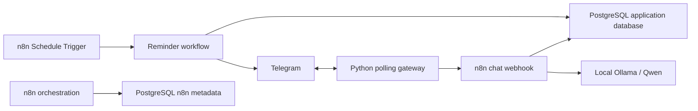

# Dincharya AI architecture

This describes repository configuration and reviewed private evidence, not a new
live-service health check. Runtime operations remain approval-gated. See
[decisions](DECISIONS.md), [roadmap](ROADMAP.md) and [handoff](HANDOFF.md).

## Application components

| Component | Current role and evidence |
| --- | --- |
| Python Telegram gateway | Polls Telegram; authorizes one user in private chats; handles /start and forwards text to the local n8n webhook. Source is in telegram-gateway/. |
| n8n | Chat orchestration, local LLM calls, schedule decisions and reminders. Compose service n8n exposes only 127.0.0.1:5678. Four workflow records were privately reviewed; no production workflow JSON is adopted as repository source. |
| PostgreSQL 17 | Compose service postgres, shared persistent postgres_data volume. n8n metadata and application data use separate databases; the documented application database is dincharya_app. |
| Ollama / Qwen2.5 3B | Local LLM backend documented for the live workflow. Not defined as a service in compose.yaml; host installation/supervision is not represented here. |
| Ubuntu WSL2 | Current host platform. Application/node scheduling timezone is Asia/Kolkata. An India-based VPS is planned, not deployed by this work. |

Compose defines only postgres and n8n. Its PostgreSQL image is postgres:17; its n8n
image is a mutable latest tag. Administrator-provided source/image evidence
identifies n8n 2.47.3 with n8n-nodes-base 2.47.2. That evidence does not prove
historical executions used the same build. Production image pinning is future
controlled work; production Compose was not changed. n8n_data stores the node
user directory separately from PostgreSQL data.

## Database and workflow source gap

The private schema capture contains four application tables: schedule_events,
recurrence_rules, schedule_change_requests and reminder_deliveries, plus 11
function definitions. Scheduling functions cover occurrence generation, conflict
checks, proposal validation and decision/approval dispatch. Exact definitions and
signatures remain private; they are not reconstructed from function names.

m2a/ contains an earlier schedule_events-only schema and non-repeat-safe routine
seeds. It is historical material, not a migration chain or the current live schema.
Never replay it over the working database. database/baseline/ and workflows/
currently contain adoption guidance, not the adopted production baseline.

Only three n8n backup tables were selectively extracted by the administrator:
workflow_history, workflow_published_version, workflow_publish_history. Reviewed
results: 94 historical versions for four current workflows; one current publication
reference and 11 distinct historical event/version references resolve. Versionless
events remain preserved without fabricated identifiers. Current nodes/connections
match their same-version history; the referenced published definition differs
only by one node's position. Original identifiers and records stay private.

History provides node/connection bodies but not full historical settings/staticData.
Current and published representations stay separate; settings/state are never
borrowed to make an incomplete published export appear complete. Two current
structural candidates pass adapters. The other two are archived unchanged behind
native-state/Code acceptance gates. No importability or execution is established.

## Native scheduler state

The exact exported ScheduleTrigger.node.js and GenericFunctions.js use
recurrenceRules as per-rule last-run values that gate scheduled emissions, and
recurrenceRuleSignatures as interval type/size bookkeeping to re-arm stale state.
Both are native n8n class-B persistent state for the reviewed image, not application
recurrence definitions or reminder-delivery records. Values were preserved.

Scheduled setup can re-arm/trim state; manual triggering bypasses the recurrence
filter. A separate emitted deduplication key uses workflow/node/scheduled-time
identity. This is not an exactly-once reminder guarantee. Import API behavior,
engine persistence flushing, restart loading and historical compatibility require
integration evidence. See [source conclusions](native-scheduler-state.md).

## Offline tooling and trust boundaries

- scripts/source_sync.py and validation tools prepare private candidates, preserve
  SQL bytes, retain version/credential-reference provenance and reject unknown or
  sensitive structures. They do not deploy, import or promote source.
- Extraction/version tools parse only approved tables and COPY text without SQL
  execution. JSON object-key order is ignored for comparison; arrays, scalar types,
  parameters and Code strings remain significant. Original bytes are not rewritten.
- Source-review tools inspect library text and hash-bound evidence without loading
  JavaScript. The computed-member warning was traced to returned array literals;
  this is not a security clearance for the seven Code nodes.
- Private raw data, identities, credentials and detailed provenance stay outside
  Git, with mode 700 directories and 600 files. Unix permissions are not encryption;
  temporary /tmp reports can expire. Hashes do not authenticate a wholly replaced set.

## Prepared Milestone 2C environment

[Standalone configuration](../tests/integration/compose.json) defines postgres-test,
n8n-test and mock-services on an internal network, with no host ports or production
mounts. Images must be verified local IDs; pulls and automatic restarts are disabled.
Runtime storage is tmpfs. Only explicit synthetic fixture files are mounted read-only.

Fresh databases dincharya_n8n_test and dincharya_app_test receive only test metadata
and invented data. Test credentials/keys are generated for the session, not copied
from production or stored in Git. Mocks provide bounded synthetic Telegram/Ollama
HTTP responses without outbound calls or payload logs. No polling or Code workflow
is included. Only configuration/contracts have been checked; no test containers,
SQL initialization or workflow imports have been run by Codex. See the
[integration runbook](../tests/integration/README.md).

## Outstanding risks

Live webhook authentication, least-privilege roles, process supervision, dependency
pinning, reliable reminder delivery, full restore readiness and VPS hardening remain
separate work. Current source does not reproduce the entire working system from
scratch. Private conversion, static tests and matching version identifiers do not
prove deployed behavior or authorize real-state changes.

## Superseding synthetic integration checkpoint

2C has now passed on the pinned n8n 2.47.3 / nodes-base 2.47.2 image. Its default
durable scheduler intercepts Schedule Trigger registrations and persists jobs
and occurrences in scheduled_job/scheduled_task. The earlier node-source findings
about recurrence arrays remain valid source findings but do not establish which
engine controlled historical production executions. Synthetic durable job IDs,
clocks, occurrence identities, successful fast emissions and n8n-only restart
recovery were verified; imported legacy arrays were retained. The seven-minute
rule's full interval was not observed.

The test create API drops staticData; native CLI import preserves it. A bounded
cache tmpfs is required for read-only test n8n startup. All successful test runs
verified project teardown and unchanged original running container IDs.

New application migrations extend the authorized schema without copying it into
Git. Gregorian occurrence/approval and reminder SQL assertions passed on a fresh
disposable application DB. The injected worker has offline tests; production
adapters/workflow wiring remain absent. The newly added multi-session and
checksum-corruption checks are not integration-tested. Original provenance
manifest location remains unconfirmed; see HANDOFF.md for the stop checkpoint.

## Post-PR #1 development boundary

PR #1 merged at `f3db2ff` with isolated one-time Telegram reminder acceptance and
HTTP 429 quarantine. This is an opt-in gateway/application adapter path, not a
production cutover. Multi-session decisions/claims and acknowledgement passed;
checksum-corruption rejection and broader legacy/recovery paths remain open.
No Hindu Panchang calculation engine is adopted yet. Its source/tradition and
geographic/reference policy require an owner decision before committing to an
engine or schema. All Milestone 2, including Panchang and operational acceptance,
precedes other domains/orchestrators; see [plan](MILESTONE2_PLAN.md).

## Offline lunar identity proposal (not persistence adoption)

Research recurrence v2 separates logical calendar identity (convention, month,
ordinary/Adhika, fixed lunation-cycle discriminator, paksha/tithi) from calculation
profile and selected Gregorian date/policy. An engine change must not blindly
append new logical occurrences. Offline comparison rejects changed identity sets
and withholds changed selected dates. See [contract and proposed calendar-date
gate](M2F_MONTH_COVERAGE.md). Future persistence requires reviewed per-series scope,
one-to-one v1 research-key mapping and explicit ambiguous/date-changing
reconciliation policy. No database schema or live architecture changed.

The bounded [pre-integration assessment](M2F_PREINTEGRATION_ASSESSMENT.md) separates
pure calendar preview readiness from persistence safety. Research comparison now
rejects approval/delivery application state and withholds policy changes on matching
calendar keys. It cannot preserve or mutate a real approval/delivery ledger because
there is no lunar adapter. A synthetic in-memory contract-adapter test is proposed
only; owner approval is required before implementation. No live architecture changed.

## Authorized synthetic in-memory lunar contract

The owner subsequently authorized the [in-memory contract](M2F_MEMORY_CONTRACT.md)
on development/m2f-memory-contract. Two synthetic immutable series scope calendar
keys; per-occurrence frozen approval snapshots gate an immutable fake ledger.
Sent/uncertain fixtures cannot be changed and no worker/transport/database exists.
This implements the previous proposed offline seam only, not the live diagram or
SQL architecture. PostgreSQL mapping/auth/transaction/locking review remains a
separate approval gate; no migration or n8n/Telegram change is included.

## Isolated lunar PostgreSQL implementation — runtime acceptance pending

The owner authorized the [mapping implementation](M2F_POSTGRESQL_RESULTS.md),
based on the [reviewed design](M2F_POSTGRESQL_DESIGN.md). Additive0006 projects each
approved logical lunar occurrence into one existing managed Gregorian once event.
Six private tables retain identities/provenance/authority; immutable actions also
hold approved revisions, avoiding a duplicate revision table. Existing native
requests, generator, conflict decision, ledger, worker and receipts are reused.

Trusted database session identity, scoped non-login executor, mapped-event guards,
shared scheduler mutex and immutable review fingerprints gate atomic approval and
projection. Never-attempted replacement preserves event ID; cancellations retain
tombstones and terminal history. Series cancel uses an explicit bounded manifest.
No separate scheduler/worker or change to n8n. One at-event reminder is the initial
synthetic seam; full advance/multiple-slot support remains outstanding.

Implementation and mocked/offline checks are complete at this checkpoint; SQL has
NOT been installed/compiled/executed. T00–T26 harness execution requires separate
owner authorization. No production auth rollout, model adoption or live scheduling.
